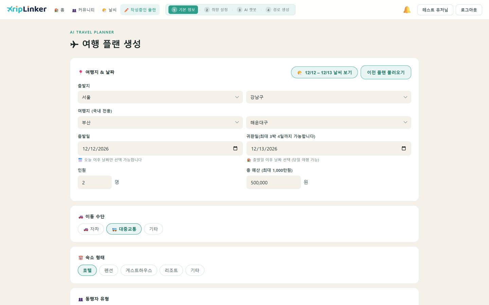
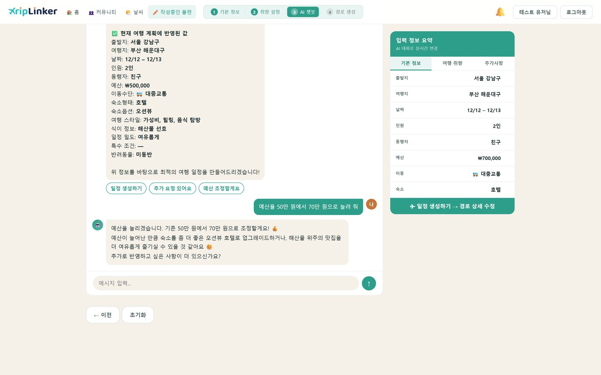
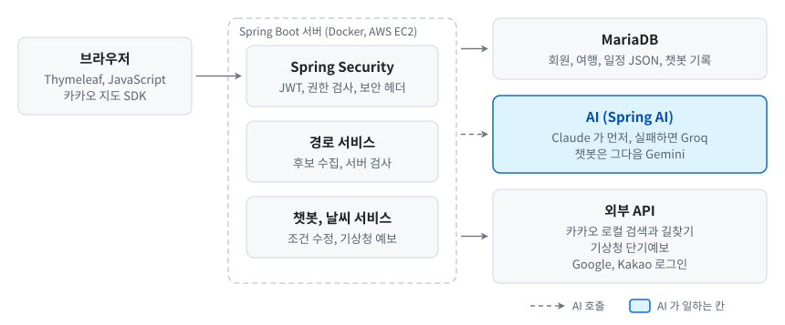
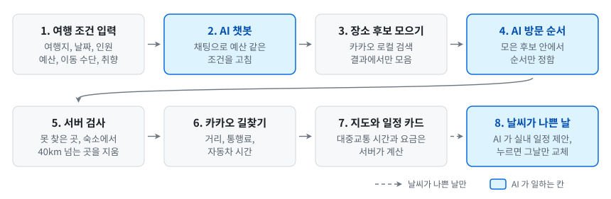
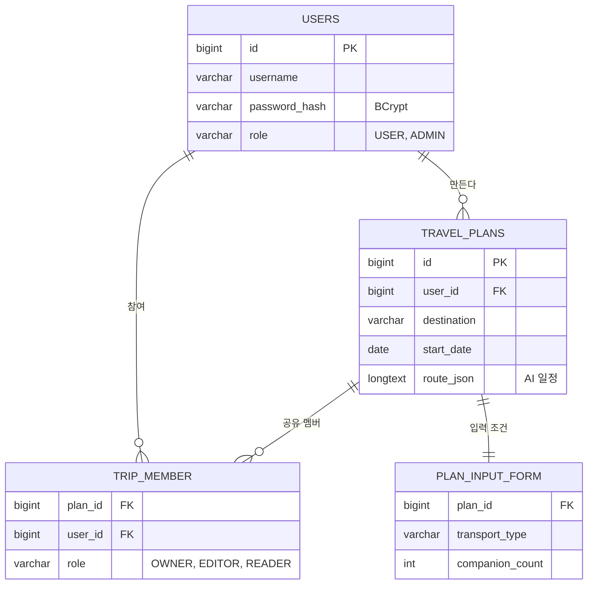
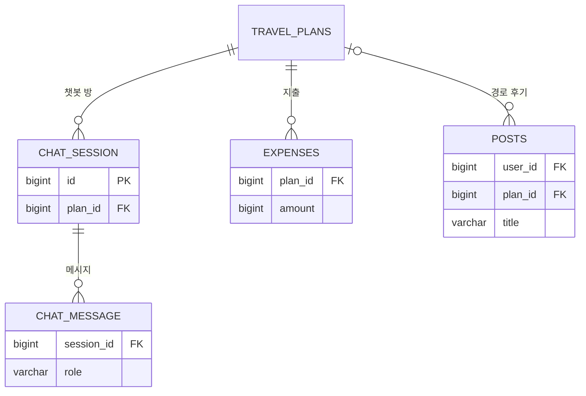
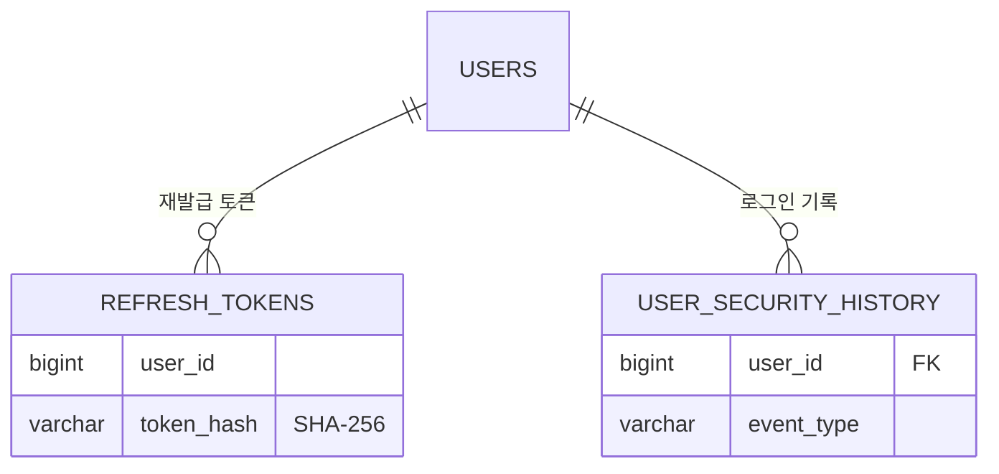

<div align="center">


# TripLinker

여행지, 날짜, 인원, 예산을 넣으면 일자별 동선과 예산이 담긴 여행 일정을 만들어 주는 서비스

[](#기술-스택)
[](#기술-스택)
[](#기술-스택)
[](#기술-스택)
[](#기술-스택)
[](#기술-스택)
[](#기술-스택)
[](#기술-스택)
[](#실행-방법)
[](#기술-스택)

[서비스 열기](https://triplinker.r-e.kr)  |  [팀 저장소](https://github.com/seolgi100/trip-linker)

</div>

---

## 목차

- [소개](#소개)
- [화면](#화면)
- [주요 기능](#주요-기능)
- [전체 구조](#전체-구조)
- [일정이 만들어지는 흐름](#일정이-만들어지는-흐름)
- [ERD](#erd)
- [담당 작업과 팀원 작업](#담당-작업과-팀원-작업)
- [AI 활용](#ai-활용)
- [트러블슈팅](#트러블슈팅)
- [보안 점검](#보안-점검)
- [기술 스택](#기술-스택)
- [실행 방법](#실행-방법)
- [폴더 구조](#폴더-구조)

## 소개

| 항⁠목 | 내용 |
|---|---|
| 한⁠ ⁠줄 | 여행지, 날짜, 인원, 예산을 넣으면 일자별 동선과 예산이 담긴 일정을 만든다 |
| 만⁠든⁠ ⁠이⁠유 | 여행 일정 하나를 정하려고 여러 페이지를 열어 두던 일을 한 서비스로 묶기 위해 |
| 기⁠간⁠과⁠ ⁠팀 | 2026.05~06, 대우능력개발원 KDT 팀 프로젝트 4인, 팀장 |
| 서⁠비⁠스 | https://triplinker.r-e.kr |
| 팀⁠ ⁠저⁠장⁠소 | https://github.com/seolgi100/trip-linker |

### 이 저장소와 팀 저장소

팀 저장소의 이력을 그대로 가져온 뒤, 팀 프로젝트가 끝나고 따로 점검하고 고친 코드를 이어서 올린 저장소다. 팀 저장소 develop 의 마지막 커밋 `0470ac1`(2026-08-21)까지가 팀 이력이고, 그 뒤 커밋(2026-08-30 `c59e96d` 부터)은 팀 프로젝트 이후의 수정이라 팀 저장소에는 올리지 않았다.

## 화면

| 1⁠.⁠ ⁠여⁠행⁠ ⁠조⁠건⁠ ⁠입⁠력 | 2. AI 챗봇으로 조건 수정 |
|---|---|
|  |  |
| 출발지, 여행지, 날짜, 인원, 총 예산과 이동 수단, 숙소, 취향 선택 | 「예산을 50만 원에서 70만 원으로 늘려 줘」 라고 하면 오른쪽 입력 요약이 바로 바뀜 |
| **3. 경로 지도** | **4. 날씨가 나쁜 날** |
|  |  |
| 일자별 일정 카드, 지도 위 방문 순서, 이동 시간과 비용 | 기상청 예보를 보여 주고 그날 야외 일정을 실내로 바꿀지 물음 |

<details>
<summary>휴대폰 화면 보기</summary>

<br>


</details>

## 주요 기능

| 기⁠능 | 설명 | 담당 |
|---|---|---|
| A⁠I⁠ ⁠일⁠정⁠ ⁠생⁠성 | 여행지, 날짜, 인원, 예산으로 일자별 동선과 예산이 담긴 일정 생성 | 공동(팀원 1명) |
| A⁠I⁠ ⁠챗⁠봇 | 채팅으로 예산 같은 여행 조건 수정 | 공동(팀원 1명) |
| 날⁠씨⁠와⁠ ⁠실⁠내⁠ ⁠대⁠체⁠ ⁠일⁠정 | 기상청 단기예보 표시, 날씨가 나쁜 날은 실내 대체 일정 제안 | 본인 |
| 로⁠그⁠인⁠ ⁠잠⁠금⁠과⁠ ⁠접⁠속⁠ ⁠기⁠록 | 로그인 5회 실패 시 5분 잠금, 로그인 기록 | 본인 |
| 관⁠리⁠자⁠ ⁠페⁠이⁠지 | 회원, 신고, 통계 관리 | 공동 |
| 로⁠그⁠아⁠웃⁠과⁠ ⁠탈⁠퇴⁠ ⁠처⁠리 | 로그아웃 시 Refresh 토큰 삭제, 소셜 로그인 계정 탈퇴 처리 | 본인 |
| 회⁠원⁠ ⁠가⁠입⁠과⁠ ⁠토⁠큰⁠ ⁠발⁠급 | 이메일 인증 가입, JWT 발급 | 팀원 |
| 소⁠셜⁠ ⁠로⁠그⁠인 | Google, Kakao 로그인 연동 | 팀원 |
| 지⁠도 | 카카오 지도 위 경로 표시, 장소 교체와 순서 바꾸기 | 팀원 |
| 가계부, 일정 공유, 커뮤니티 | 지출 기록, 공유 링크와 멤버, 경로 후기 게시판 | 팀원 |

## 전체 구조

장소 후보와 거리, 시간은 카카오 API 결과만 쓰고, AI 에는 순서와 문장만 맡긴다. 파란 칸이 AI 다.

<picture>
  <source media="(prefers-color-scheme: dark)" srcset="docs/images/diagram_arch_dark.svg">
  
</picture>

## 일정이 만들어지는 흐름

<picture>
  <source media="(prefers-color-scheme: dark)" srcset="docs/images/diagram_flow_dark.svg">
  
</picture>

이름이 같은 다른 지역 가게는 지역 이름을 붙여 다시 검색한다. 5번 서버 검사는 카카오에서 위치를 못 찾은 곳과 그날 숙소에서 40km 넘게 떨어진 곳을 지우되, 사용자가 직접 고른 곳은 지우지 않고 알림만 띄운다. 숙소가 없는 날은 그날 장소들의 중심에서 40km 를 재고, 한 번 찾은 좌표는 저장해 두고 다시 쓴다.

## ERD

서비스의 핵심 테이블만 추렸다. AI 가 만든 일정은 `TRAVEL_PLANS.route_json` 에 저장한다.

회원과 여행



여행에 딸린 챗봇, 가계부, 커뮤니티



로그인 보안



## 담당 작업과 팀원 작업

| 구⁠분 | 내용 |
|---|---|
| 담⁠당⁠ ⁠작⁠업 | AI 일정 생성과 챗봇(팀원 한 명과 함께), 기상청 날씨 연동, 로그인 5회 실패 시 5분 잠금, 접속 기록, 관리자 페이지(팀원과 함께), 로그아웃 시 Refresh 토큰 삭제, 소셜 로그인 계정 탈퇴 처리 |
| 팀⁠ ⁠프⁠로⁠젝⁠트⁠ ⁠이⁠후 | [보안 점검](#보안-점검)의 점검과 수정 |
| 팀⁠원⁠ ⁠작⁠업 | 회원 가입과 토큰 발급, 소셜 로그인 연동, 지도 연동, 가계부, 일정 공유, 커뮤니티 |

## AI 활용

### 서비스 안에서 AI 가 하는 일

| 기⁠능 | AI 가 하는 일 | AI 에 맡기지 않은 일 | 모델 |
|---|---|---|---|
| 일⁠정⁠ ⁠생⁠성 | 카카오 검색으로 모은 후보 안에서 방문 순서 정하기 | 장소 고르기, 좌표, 거리, 시간, 통행료(카카오 API), 너무 먼 곳 지우기(서버) | Claude, 실패하면 Groq |
| 챗⁠봇 | 사용자 말을 알아듣고 예산 같은 여행 조건 고치기 | 다른 사람 여행 읽기(서버가 주인과 멤버만 허용) | Claude, 실패하면 Groq, 그다음 Gemini |
| 날⁠씨⁠ ⁠대⁠체 | 날씨가 나쁜 날의 야외 일정을 실내 일정으로 바꾸기 | 예보(기상청 API) | Claude, 실패하면 Groq |

### AI 로 만든 방식

프론트엔드는 AI 도구로 만들었고, 백엔드는 구조를 먼저 정한 뒤 AI 코딩 도구로 작성하고 확인했다. 처음에는 AI 에 장소와 순서를 모두 맡겼는데, 없는 장소가 섞여서 6월 29일에 구조를 바꿨다. 장소 후보를 모으는 단계에서는 AI 를 부르지 않고 카카오 검색 결과에서만 뽑으며, AI 에는 그 후보 안의 방문 순서만 맡긴다. 검사용 모델은 이때 흐름에서 뺐다.

## 트러블슈팅

<details>
<summary>1. AI 가 실제로 없는 장소를 지어냄</summary>

<br>

| 구⁠분 | 내용 |
|---|---|
| 문⁠제 | 만들어진 일정에 실제로는 없는 가게와 관광지가 섞임 |
| 원⁠인 | 장소 고르기와 순서 정하기를 모두 AI 에 맡겨서 AI 가 그럴듯한 이름을 지어낼 수 있었음 |
| 해⁠결 | 장소 후보는 카카오 검색 결과에서만 모으고, AI 에는 그 후보 안의 방문 순서만 맡김 |
| 결⁠과 | 일정에 들어가는 장소가 카카오 검색 결과 안으로 좁혀짐. 남은 빈틈 하나는 3번에서 막음 |

</details>

<details>
<summary>2. 이름이 같은 다른 지역 가게가 일정에 들어옴</summary>

<br>

| 구⁠분 | 내용 |
|---|---|
| 문⁠제 | 여행지와 다른 지역의 같은 이름 가게 좌표가 잡혀 동선이 크게 튐 |
| 원⁠인 | 장소 이름만으로 카카오에 검색해서 다른 지역 가게가 먼저 잡힐 수 있었음 |
| 해⁠결 | 여행지 지역 이름을 붙여 다시 검색(`withRegion`)하고, 그날 숙소에서 40km 넘게 떨어진 곳은 서버가 마지막에 지움. 사용자가 직접 고른 장소는 지우지 않고 알림만 띄움 |
| 결⁠과 | 이름이 같은 다른 지역 가게가 걸러짐 |

</details>

<details>
<summary>3. AI 가 적어 넣은 좌표를 서버가 그대로 믿음</summary>

<br>

| 구⁠분 | 내용 |
|---|---|
| 문⁠제 | 11월 점검에서, AI 가 지어낸 장소가 「좌표를 못 찾은 장소 지우기」 검사를 통과할 수 있는 빈틈을 찾음 |
| 원⁠인 | AI 답에 좌표가 들어 있으면 서버가 그 좌표를 카카오에서 찾은 좌표처럼 믿었음 |
| 해⁠결 | 카카오에서 찾은 좌표만 쓰게 고침. 그 상황을 재현하는 테스트(`AiCoordinateTrustTest`)를 먼저 만듦 |
| 결⁠과 | 테스트가 고치기 전에는 실패하고 고친 뒤에는 통과 |

</details>

## 보안 점검

팀 프로젝트가 끝난 뒤, 직접 만든 점검 가이드로 처음부터 다시 점검했다. 가이드는 어느 웹 서비스에나 쓸 수 있게 항목과 순서를 정해 둔 것이고, 기준은 KISA 웹 21개 항목, OWASP Top 10, OWASP Top 10 for LLM Applications(AI 기능)다. 가이드 순서대로 고친 뒤 측정 사이트와 도구, 자동 테스트로 다시 측정했고, 고칠 때마다 문제를 재현하는 테스트 케이스를 함께 만들었다.

### 결과 요약

| 항⁠목 | 결과 |
|---|---|
| 찾⁠은⁠ ⁠것 | 41건(상 8, 중 18, 하 15) |
| 고⁠친⁠ ⁠것 | 32건 |
| 남⁠긴⁠ ⁠것 | 9건, 이유를 적어 남김 |
| 재⁠현⁠ ⁠테⁠스⁠트 | 68건 중 고치기 전 실패한 43건이 고친 뒤 모두 통과 |

| 측⁠정 | 고치기 전 | 고친 뒤 |
|---|---|---|
| Mozilla Observatory 보안 설정 | B (70점) | B (75점) |
| W⁠3⁠C⁠ ⁠웹⁠ ⁠표⁠준 | 오류 83건, 경고 20건 | 오류 0건, 경고 6건 |
| L⁠i⁠g⁠h⁠t⁠h⁠o⁠u⁠s⁠e⁠ ⁠모⁠바⁠일 | 접근성 70, 검색 노출 67, 권장 사항 96 | 접근성 100, 검색 노출 100, 권장 사항 100 |
| 화⁠면⁠ ⁠밀⁠림⁠(⁠C⁠L⁠S⁠) | 0.239 | 0 |
| SpotBugs 보안 분류 실제 위험 | 4건 | 0건 |
| S⁠S⁠L⁠ ⁠L⁠a⁠b⁠s | 고친 뒤만 측정 | A+ |

<details>
<summary>고친 것 자세히 (기준, 문제, 고친 방법, 테스트)</summary>

<br>

| 기⁠준 | 문제 | 고친 방법 | 테스트 |
|---|---|---|---|
| KISA IN, OWASP A01 | 여행, 일정, 공유 멤버, 여행 조건, 챗봇 방, 회원 정보 API 가 로그인 여부만 확인 | 요청한 사람이 그 여행의 주인이나 멤버인지 서버가 확인(`TripAccessGuard`), 공유 링크 토큰은 HMAC-SHA256 | `AccessControlTest` |
| KISA IL, OWASP A01 | 숨김 글 본문이 목록과 상세 API 로 누구에게나 나감 | 숨김 글은 작성자와 관리자만 봄 | `HiddenPostTest` |
| KISA XS, OWASP A03 | 장소 이름, 관리자 목록, 챗봇 태그를 이스케이프 없이 화면에 넣음 | 화면에 넣기 전에 이스케이프 | (화면 코드) |
| KISA FU, OWASP A03 | 업로드 파일의 확장자와 내용을 보지 않음 | jpg, png, gif, webp 만 받고 파일 앞머리까지 확인, 저장 이름은 서버가 정함 | `UploadTest` |
| KISA PR, PV, AU, OWASP A07 | 인증번호 무제한 시도와 재사용, 이메일 인증을 화면에서만 확인, 인증 메일 무제한 발송 | 여러 번 틀리면 다시 받게 하고 쓴 번호는 폐기, `SecureRandom`, 인증 마친 이메일인지 서버가 확인, 발송 횟수 제한 | `AuthAbuseTest` |
| KISA IA, BF, OWASP A07 | 탈퇴가 토큰만으로 통과, 마이페이지 비밀번호 변경 규칙을 서버가 보지 않음 | 일반 계정은 비밀번호, 소셜 계정은 확인 문구를 서버가 확인, 가입과 같은 비밀번호 규칙을 서버에서 확인 | `AccountChangeTest` |
| KISA AU, OWASP A07 | 로그인 뒤의 비밀번호 확인, 변경, 탈퇴에 횟수 제한이 없어 로그인 잠금을 돌아갈 수 있음 | 세 주소를 합쳐 회원별로 횟수를 세고 넘으면 429 | `PasswordCheckLimitTest` |
| O⁠W⁠A⁠S⁠P⁠ ⁠A⁠0⁠7 | 소셜 로그인 토큰이 주소 `?` 뒤에 실림 | 주소에 토큰을 싣지 않음 | `OAuthRedirectTest` |
| L⁠L⁠M⁠ ⁠출⁠력⁠ ⁠검⁠증 | AI 가 적어 넣은 좌표를 그대로 믿음 | 카카오에서 찾은 좌표만 씀 | `AiCoordinateTrustTest` |
| L⁠L⁠M⁠ ⁠무⁠제⁠한⁠ ⁠호⁠출 | AI 호출 횟수와 챗봇 글 길이에 제한이 없음 | 회원별 횟수 제한, 글 길이 제한 | `AiCallLimitTest` |
| O⁠W⁠A⁠S⁠P⁠ ⁠A⁠0⁠5 | 보안 헤더 없음, 인증 정보를 허용하는 CORS, 디버그 로그 | CSP, Referrer-Policy, Permissions-Policy 추가, CORS 인증 정보 끔, SQL 출력과 Security DEBUG 로그 끔 | `SecurityConfigWebTest` |
| O⁠W⁠A⁠S⁠P⁠ ⁠A⁠0⁠6 | 알려진 취약점이 있는 판 | Spring Boot, Tomcat, Jackson, MariaDB 드라이버, Spring AI 판 올림 | 전체 테스트 |
| O⁠W⁠A⁠S⁠P⁠ ⁠A⁠0⁠8 | CDN 스크립트에 무결성 값 없음 | SRI(`integrity`) 추가 | (스크립트 검사) |
| O⁠W⁠A⁠S⁠P⁠ ⁠A⁠0⁠9 | 남의 데이터에 손대다 막힌 요청(403)이 기록되지 않음 | 방법, 주소, 회원 번호만 경고 로그로 남김(다른 개인정보는 남기지 않음) | `ForbiddenLogTest` |

</details>

<details>
<summary>남긴 것과 이유 (9건)</summary>

<br>

| 남⁠긴⁠ ⁠것 | 이유 |
|---|---|
| 로그아웃한 뒤에도 이미 받은 Access 토큰은 만료(30분)까지 쓰임 | 바로 막으려면 요청마다 DB 를 확인해야 해서, 토큰 수명을 30분으로 짧게 둔 팀 방식을 유지. Refresh 토큰은 로그아웃 때 DB 에서 지움 |
| 일부 코드의 `System.out` 로그 | 동작과 관계없음. 이번에 손댄 곳만 로거로 바꿈 |
| 로그인 실패 문구로 아이디가 있는지 알 수 있음 | 아이디 중복 확인 API 가 원래 공개라 이것만 막는 의미가 작음 |
| 실패 이력의 IP 를 `X-Forwarded-For` 첫 값으로 기록 | 기록에만 영향(잠금과 무관). 운영 앞단 구성을 보고 고칠 일 |
| 프⁠롬⁠프⁠트⁠ ⁠주⁠입 | 권한 검사를 고친 뒤 영향이 자기 여행 안에 그침. 사용자 글을 프롬프트에서 빼면 챗봇 기능이 깨짐 |
| AI 답의 태그가 여행 조건을 사용자 확인 없이 고침 | 범위가 그 여행의 조건 칸뿐. 확인 단계를 넣으면 화면 흐름이 바뀜 |
| Docker 기반 이미지 다이제스트 고정 안 함 | 고정하면 보안 패치를 손으로 따라가야 해서 태그를 유지 |
| 운영 계정과 운영 설정 값 2건 | 운영자가 직접 바꿀 값이라 저장소 코드로 고치지 않음. 세부는 공개하지 않음 |

</details>

### 권한 검사, 보안 헤더, 개인정보

| 항⁠목 | 내용 |
|---|---|
| 권⁠한⁠ ⁠검⁠사 | 로그인은 `Authorization` 헤더의 JWT 로 확인(서버 세션 없음). 여행에 딸린 API 는 `TripAccessGuard` 가 주인과 멤버인지 확인하고, 아니면 막는 쪽이 기본. `/api/admin/**` 은 서버가 관리자 역할을 확인하고, 체험용 관리자는 읽기만 가능 |
| 보⁠안⁠ ⁠헤⁠더 | `Content-Security-Policy`, `Referrer-Policy: strict-origin-when-cross-origin`, `Permissions-Policy`(카메라, 마이크, 위치, 결제, USB 끔), Spring Security 기본값 `X-Frame-Options`, `X-Content-Type-Options`. CSP `script-src` 에서는 `'unsafe-inline'` 을 뺐고(화면 인라인 스크립트를 파일로 옮김), 화면이 style 속성을 많이 써서 `style-src` 에만 남아 있음 |
| 비⁠밀⁠ ⁠값⁠ ⁠저⁠장 | 비밀번호는 BCrypt, Refresh 토큰은 SHA-256 해시만 저장. 설정 파일은 저장소에 올리지 않음 |
| 개⁠인⁠정⁠보⁠ ⁠가⁠림 | 체험용 관리자가 관리자 API 를 읽으면 다른 회원의 이름, 이메일, 아이디, 전화번호를 가린 값으로 내려줌(`DemoAdminMaskingAdvice`). 권한 거부 로그에는 개인정보를 남기지 않음 |
| 테⁠스⁠트 | 건마다 문제를 재현하는 테스트를 먼저 만들어 고치기 전 실패, 고친 뒤 통과를 확인. 보안 테스트는 `src/test/java/idusw/sbb/triplinker/security/` |

## 기술 스택

| 영⁠역 | 기술 |
|---|---|
| 백⁠엔⁠드 | Java 21, Spring Boot 3.5, Spring Security(JWT, OAuth 2.0), Spring Data JPA, Spring AI |
| 화⁠면 | Thymeleaf, JavaScript, 카카오 지도 SDK |
| D⁠B | MariaDB |
| A⁠I | Claude, Groq, Gemini (Spring AI 로 호출) |
| 외⁠부⁠ ⁠A⁠P⁠I | 카카오 로컬 검색, 카카오모빌리티 길찾기, 기상청 단기예보, Google 과 Kakao 로그인 |
| 배⁠포⁠와⁠ ⁠도⁠구 | Docker, AWS EC2, Gradle, SpotBugs(FindSecBugs), JUnit 5 |

## 실행 방법

설정 파일(`src/main/resources/application*.properties`)과 값은 저장소에 없다. 아래 키를 설정 파일이나 환경 변수로 넣은 뒤 실행한다.

<details>
<summary>필요한 설정 키 이름</summary>

<br>

| 묶⁠음 | 키 이름 |
|---|---|
| D⁠B | `spring.datasource.url`, `spring.datasource.username`, `spring.datasource.password` |
| J⁠W⁠T | `jwt.secret`, `jwt.access-token-validity-in-milliseconds`, `jwt.refresh-token-validity-in-milliseconds` |
| 공⁠유⁠ ⁠링⁠크 | `app.share.secret` |
| 소⁠셜⁠ ⁠로⁠그⁠인 | `spring.security.oauth2.client.registration.google.*`, `spring.security.oauth2.client.registration.kakao.*`, `kakao.admin-key` |
| 카⁠카⁠오 | `kakao.maps.api.key`, `kakao.rest.api.key` |
| 기⁠상⁠청 | `weather.api.key` |
| 예⁠산⁠ ⁠요⁠금⁠ ⁠조⁠회 | `tour.api.key`, `tour.api.base-url` |
| A⁠I | `spring.ai.anthropic.*`, `spring.ai.openai.*`(Groq), `spring.ai.google.genai.*` |
| 메⁠일 | `spring.mail.*` |
| 업⁠로⁠드 | `file.upload.path`, `file.upload.url` |
| 체⁠험⁠ ⁠로⁠그⁠인 | `app.demo.login.*`, `app.demo.route.*` |

</details>

```bash
# 테스트 (DB 가 있어야 도는 기동 테스트는 DB 설정이 있어야 통과)
./gradlew test

# 실행
./gradlew bootRun

# Docker 이미지
docker build -t triplinker .
```

## 폴더 구조

```text
src/main/java/idusw/sbb/triplinker
├── config            보안 설정(SecurityConfig), 웹 설정
├── domain
│   ├── route         AI 일정 생성, 장소 교체, 실내 대체
│   ├── chat          AI 챗봇
│   ├── weather       기상청 단기예보
│   ├── plan          여행 플랜, 입력 조건, 권한 검사(TripAccessGuard)
│   ├── planshare     공유 멤버와 공유 링크
│   ├── budget        예산 계산
│   ├── expense       가계부
│   ├── place         장소
│   ├── post          커뮤니티
│   ├── auth          로그인, JWT, 소셜 로그인
│   ├── user          회원, 로그인 기록
│   ├── admin         관리자
│   ├── demo          체험 로그인
│   └── system        알림, 신고
└── global            횟수 제한, 예외 처리, 공통 코드
src/main/resources
├── templates         Thymeleaf 화면
└── static            JavaScript, CSS, 그림
src/test/java/idusw/sbb/triplinker
└── security          점검 때 만든 재현 테스트
```
