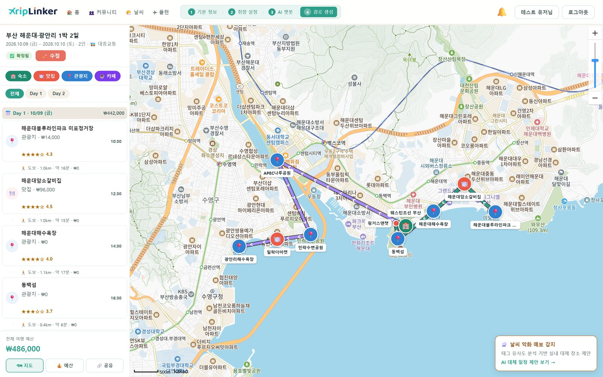
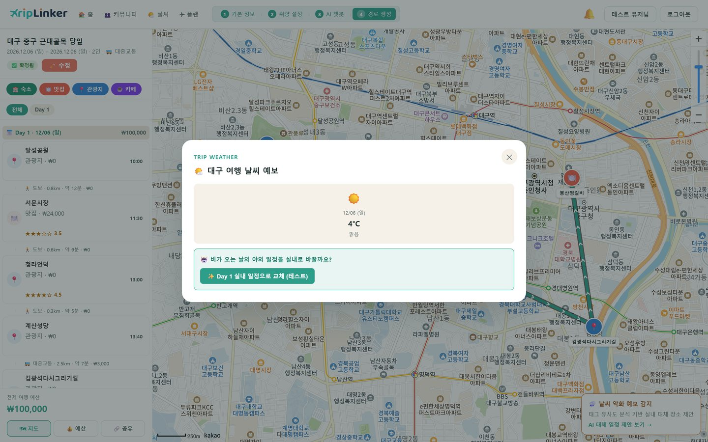
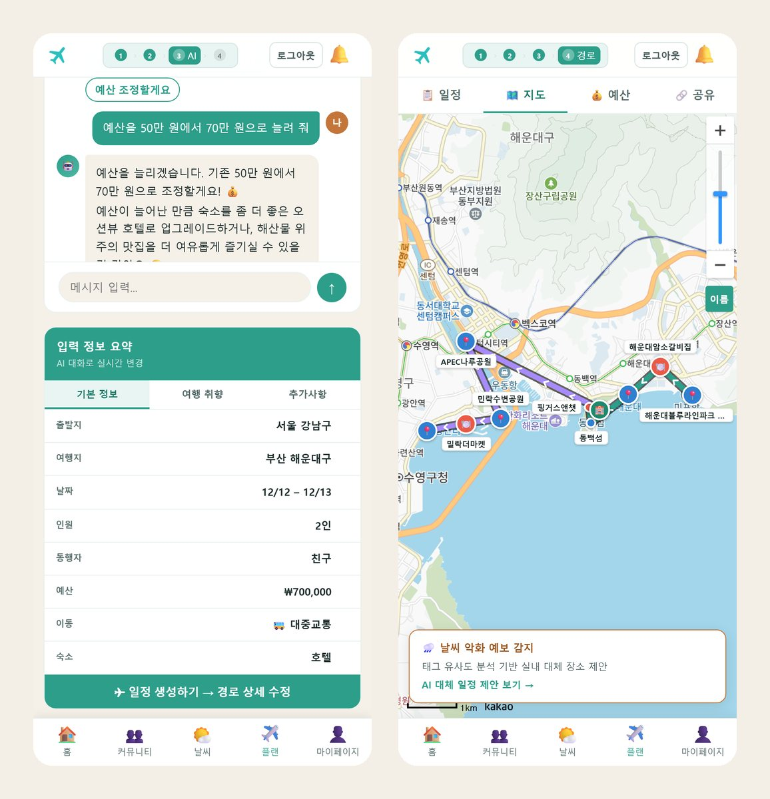
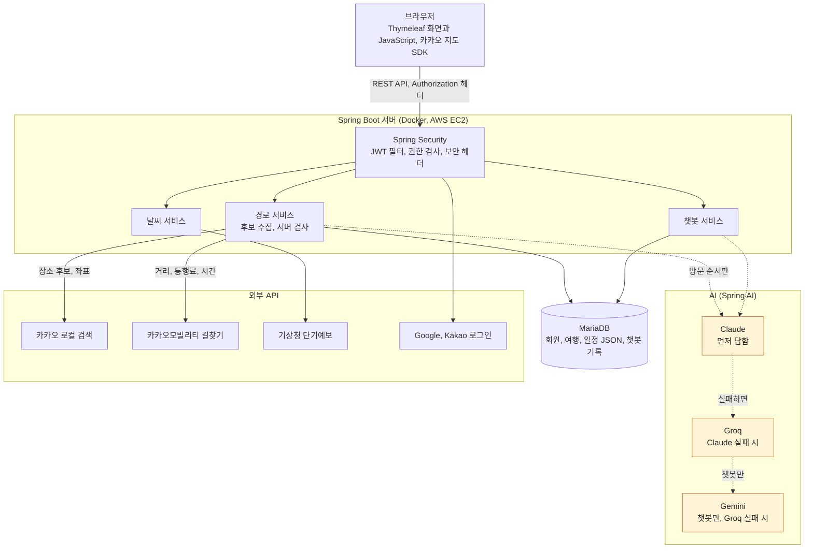
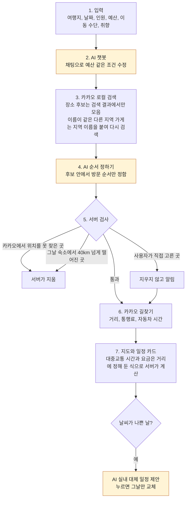
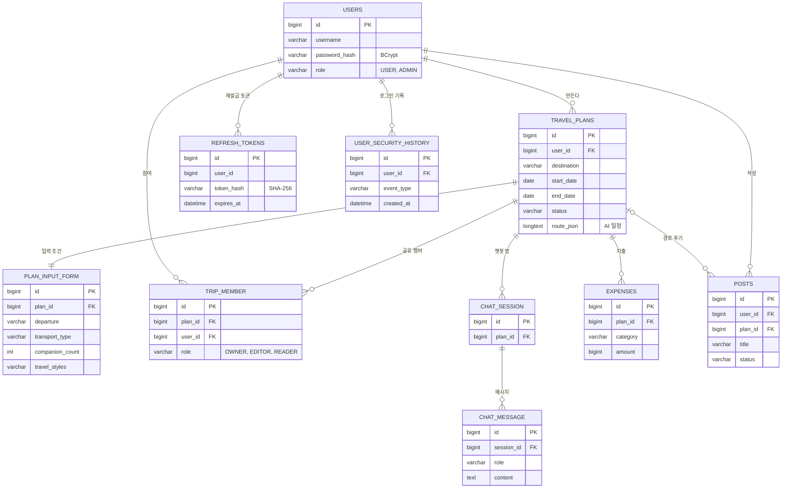

<div align="center">



# TripLinker

**여행지, 날짜, 인원, 예산을 넣으면 일자별 동선과 예산이 담긴 여행 일정을 만들어 주는 서비스**

[](#기술-스택)
[](#기술-스택)
[](#기술-스택)
[](#기술-스택)
[](#기술-스택)
[](#기술-스택)
[](#기술-스택)
[](#기술-스택)
[](#실행-방법)
[](#기술-스택)

[서비스 열기](https://triplinker.r-e.kr) &nbsp;|&nbsp; [팀 저장소](https://github.com/seolgi100/trip-linker)

</div>

---

## 목차

- [소개](#소개)
- [화면](#화면)
- [주요 기능](#주요-기능)
- [전체 구조](#전체-구조)
- [일정이 만들어지는 흐름](#일정이-만들어지는-흐름)
- [ERD](#erd)
- [맡은 것과 팀원 몫](#맡은-것과-팀원-몫)
- [AI 활용](#ai-활용)
- [트러블슈팅](#트러블슈팅)
- [보안 점검](#보안-점검)
- [기술 스택](#기술-스택)
- [실행 방법](#실행-방법)
- [폴더 구조](#폴더-구조)

## 소개

| 항목 | 내용 |
|---|---|
| 한 줄 | 여행지, 날짜, 인원, 예산을 넣으면 일자별 동선과 예산이 담긴 일정을 만들어 줍니다 |
| 왜 만들었나 | 여행 일정 하나를 정하려고 여러 페이지를 열어 두던 일을 한 서비스로 묶고 싶었습니다 |
| 기간과 팀 | 2026.05~06, 대우능력개발원 KDT 팀 프로젝트 4인, 팀장 |
| 서비스 | https://triplinker.r-e.kr |
| 팀 저장소 | https://github.com/seolgi100/trip-linker |

### 이 저장소와 팀 저장소

이 저장소는 팀 저장소의 이력을 그대로 가져온 뒤, 팀 프로젝트가 끝나고 제가 따로 점검하고 고친 코드를 이어서 올린 곳입니다.

- 팀 저장소 develop 의 마지막 커밋 `0470ac1`(2026-08-21)까지는 팀 이력입니다.
- 그 뒤 커밋(2026-08-30 `c59e96d` 부터)은 팀 프로젝트 이후 제가 고친 것입니다. 팀 저장소에는 올리지 않았습니다.

## 화면

| 1. 여행 조건 입력 | 2. AI 챗봇으로 조건 수정 |
|---|---|
|  |  |
| 출발지, 여행지, 날짜, 인원, 총 예산과 이동 수단, 숙소, 취향을 고릅니다 | 채팅으로 「예산을 50만 원에서 70만 원으로 늘려 줘」 라고 하면 오른쪽 입력 요약이 바로 바뀝니다 |
| **3. 경로 지도** | **4. 날씨가 나쁜 날** |
|  |  |
| 일자별 일정 카드, 지도 위 방문 순서, 이동 시간과 비용 | 기상청 예보를 보여 주고 그날 야외 일정을 실내로 바꿀지 묻습니다 |

<details>
<summary><b>휴대폰 화면 보기</b></summary>

<br>



</details>

## 주요 기능

| 기능 | 설명 | 만든 사람 |
|---|---|---|
| AI 일정 생성 | 여행지, 날짜, 인원, 예산을 넣으면 일자별 동선과 예산이 담긴 일정을 만듭니다 | 본인(팀원 한 명과 함께) |
| AI 챗봇 | 채팅으로 예산 같은 여행 조건을 고칩니다 | 본인(팀원 한 명과 함께) |
| 날씨와 실내 대체 일정 | 기상청 단기예보를 보여 주고, 날씨가 나쁜 날은 실내 대체 일정을 제안합니다 | 본인 |
| 로그인 잠금과 접속 기록 | 로그인 5회 실패 시 5분 잠금, 로그인 기록 | 본인 |
| 관리자 페이지 | 회원, 신고, 통계 관리 | 본인(팀원과 함께) |
| 로그아웃과 탈퇴 처리 | 로그아웃 시 Refresh 토큰 삭제, 소셜 로그인 계정 탈퇴 처리 | 본인 |
| 회원 가입과 토큰 발급 | 이메일 인증 가입, JWT 발급 | 팀원 |
| 소셜 로그인 | Google, Kakao 로그인 연동 | 팀원 |
| 지도 | 카카오 지도 위 경로 표시, 장소 교체와 순서 바꾸기 | 팀원 |
| 가계부, 일정 공유, 커뮤니티 | 지출 기록, 공유 링크와 멤버, 경로 후기 게시판 | 팀원 |

## 전체 구조

AI 는 노란 칸입니다. 장소 후보와 거리, 시간은 카카오 API 결과만 쓰고, AI 에는 순서와 문장만 맡깁니다.



## 일정이 만들어지는 흐름

입력에서 지도까지 한 번에 보면 이렇습니다. AI 가 나오는 칸(노란 칸)은 2번, 4번, 날씨 대체 셋입니다.



숙소가 없는 날은 그날 장소들의 중심을 기준으로 40km 를 잽니다. 한 번 찾은 좌표는 저장해 두고 다시 씁니다.

## ERD

서비스의 핵심 테이블만 추렸습니다. AI 가 만든 일정은 `TRAVEL_PLANS.route_json` 에 저장합니다.



## 맡은 것과 팀원 몫

| 구분 | 내용 |
|---|---|
| 제가 맡은 것 | AI 일정 생성과 챗봇(팀원 한 명과 함께), 기상청 날씨 연동 |
| | 로그인 5회 실패 시 5분 잠금, 접속 기록, 관리자 페이지(팀원과 함께) |
| | 로그아웃 시 Refresh 토큰 삭제, 소셜 로그인 계정 탈퇴 처리 |
| | 팀 프로젝트 이후: 아래 [보안 점검](#보안-점검)의 점검과 수정 |
| 팀원 몫 | 회원 가입과 토큰 발급, 소셜 로그인 연동, 지도 연동, 가계부, 일정 공유, 커뮤니티 |

## AI 활용

### 서비스 안에서 AI 가 하는 일

| 기능 | AI 가 하는 일 | AI 에 맡기지 않은 일 | 모델 |
|---|---|---|---|
| 일정 생성 | 카카오 검색으로 모은 후보 안에서 방문 순서 정하기 | 장소 고르기, 좌표, 거리, 시간, 통행료(카카오 API), 너무 먼 곳 지우기(서버) | Claude, 실패하면 Groq |
| 챗봇 | 사용자 말을 알아듣고 예산 같은 여행 조건 고치기 | 다른 사람 여행 읽기(서버가 주인과 멤버만 허용) | Claude, 실패하면 Groq, 그다음 Gemini |
| 날씨 대체 | 날씨가 나쁜 날의 야외 일정을 실내 일정으로 바꾸기 | 예보(기상청 API) | Claude, 실패하면 Groq |

### AI 로 만든 방식

- 프론트엔드는 AI 도구로 만들었고, 백엔드는 구조를 제가 정한 뒤 AI 코딩 도구로 작성하고 확인했습니다.
- 처음에는 AI 에 장소와 순서를 모두 맡겼다가, 없는 장소가 섞이자 장소는 카카오 검색 결과에서만 뽑고 AI 에는 순서만 맡기는 구조로 바꿨습니다.
- 6월 29일, 장소 후보를 모으는 단계에서는 AI 를 아예 부르지 않기로 정했습니다. 후보는 카카오 검색 결과에서만 뽑고 AI 에는 그 후보 안에서 방문 순서만 정해 달라고 했습니다. 검사용 모델은 흐름에서 뺐습니다.

## 트러블슈팅

<details>
<summary><b>1. AI 가 실제로 없는 장소를 지어냄</b></summary>

<br>

- **문제**: 만들어진 일정에 실제로는 없는 가게와 관광지가 섞였습니다
- **원인**: 장소를 고르는 일과 순서를 정하는 일을 모두 AI 에 맡겨서, AI 가 그럴듯한 이름을 지어낼 수 있었습니다
- **해결**: 장소 후보를 모으는 단계에서는 AI 를 부르지 않게 바꿨습니다. 후보는 카카오 검색 결과에서만 모으고, AI 에는 그 후보 안에서 방문 순서만 정하게 했습니다
- **결과**: 일정에 들어가는 장소가 카카오 검색 결과 안으로 좁혀졌습니다. 그래도 남은 빈틈 하나는 3번에서 다시 막았습니다

</details>

<details>
<summary><b>2. 이름이 같은 다른 지역 가게가 일정에 들어옴</b></summary>

<br>

- **문제**: 여행지와 다른 지역의 같은 이름 가게 좌표가 잡혀 동선이 크게 튀었습니다
- **원인**: 장소 이름만으로 카카오에 검색해서, 다른 지역의 같은 이름 가게가 먼저 잡힐 수 있었습니다
- **해결**: 여행지 지역 이름을 붙여 다시 검색하고(`withRegion`), 그날 숙소에서 40km 넘게 떨어진 곳은 서버가 마지막에 지우게 했습니다. 사용자가 직접 고른 장소는 지우지 않고 알림만 띄웁니다
- **결과**: 이름이 같은 다른 지역 가게가 걸러졌습니다

</details>

<details>
<summary><b>3. AI 가 적어 넣은 좌표를 서버가 그대로 믿음</b></summary>

<br>

- **문제**: 11월 점검에서, 좌표를 찾지 못한 장소를 지우는 검사를 AI 가 지어낸 장소가 통과할 수 있는 빈틈을 찾았습니다
- **원인**: AI 답에 좌표가 들어 있으면 서버가 그 좌표를 카카오에서 찾은 좌표처럼 믿었습니다
- **해결**: 카카오에서 찾은 좌표만 쓰게 고쳤습니다. 그 상황을 재현하는 테스트(`AiCoordinateTrustTest`)를 먼저 만들었습니다
- **결과**: 테스트가 고치기 전에는 실패하고 고친 뒤에는 통과합니다

</details>

## 보안 점검

팀 프로젝트가 끝난 뒤, 직접 만든 점검 가이드를 따라 처음부터 다시 점검했습니다. 가이드는 어느 웹 서비스에나 적용할 수 있게 항목과 순서를 정해 둔 것이고, 기준은 KISA 웹 21개 항목, OWASP Top 10, OWASP Top 10 for LLM Applications(AI 기능)입니다. 점검 가이드를 먼저 만들고 그 순서대로 고친 뒤, 측정 사이트와 도구, 자동 테스트로 다시 측정했습니다. 고칠 때마다 문제를 재현하는 테스트 케이스를 함께 만들었습니다.

### 결과 요약

| 항목 | 결과 |
|---|---|
| 찾은 것 | 41건(상 8, 중 18, 하 15) |
| 고친 것 | 32건 |
| 남긴 것 | 9건, 이유를 적어 남김 |
| 재현 테스트 | 68건 중 고치기 전 실패한 43건이 고친 뒤 모두 통과 |

| 측정 | 고치기 전 | 고친 뒤 |
|---|---|---|
| Mozilla Observatory 보안 설정 | B (70점) | B (75점) |
| W3C 웹 표준 | 오류 83건, 경고 20건 | 오류 0건, 경고 6건 |
| Lighthouse 모바일 | 접근성 70, 검색 노출 67, 권장 사항 96 | 접근성 100, 검색 노출 100, 권장 사항 100 |
| 화면 밀림(CLS) | 0.239 | 0 |
| SpotBugs 보안 분류 실제 위험 | 4건 | 0건 |
| SSL Labs | 고친 뒤만 측정 | A+ |

<details>
<summary><b>고친 것 자세히 (기준, 문제, 고친 방법, 테스트)</b></summary>

<br>

| 기준 | 문제 | 고친 방법 | 테스트 |
|---|---|---|---|
| KISA IN, OWASP A01 | 여행, 일정, 공유 멤버, 여행 조건, 챗봇 방, 회원 정보 API 가 로그인했는지만 확인 | 요청한 사람이 그 여행의 주인이나 멤버인지 서버가 확인(`TripAccessGuard`). 공유 링크 토큰은 HMAC-SHA256 으로 | `AccessControlTest` |
| KISA IL, OWASP A01 | 숨김 글 본문이 목록과 상세 API 로 누구에게나 나감 | 숨김 글은 작성자와 관리자만 보게 | `HiddenPostTest` |
| KISA XS, OWASP A03 | 장소 이름, 관리자 목록, 챗봇 태그를 이스케이프 없이 화면에 넣음 | 화면에 넣기 전에 이스케이프 | (화면 코드) |
| KISA FU, OWASP A03 | 업로드 파일의 확장자와 내용을 보지 않음 | jpg, png, gif, webp 만 받고 파일 앞머리까지 확인, 저장 이름은 서버가 정함 | `UploadTest` |
| KISA PR, PV, AU, OWASP A07 | 인증번호 무제한 시도와 재사용, 가입이 이메일 인증을 화면에서만 확인, 인증 메일 무제한 발송 | 여러 번 틀리면 다시 받게 하고 쓴 번호는 폐기, `SecureRandom`, 서버가 인증 마친 이메일인지 확인, 발송 횟수 제한 | `AuthAbuseTest` |
| KISA IA, BF, OWASP A07 | 탈퇴가 토큰만으로 통과, 마이페이지 비밀번호 변경이 서버에서 규칙을 보지 않음 | 일반 계정은 비밀번호, 소셜 계정은 확인 문구를 서버가 확인. 가입과 같은 비밀번호 규칙을 서버에서 확인 | `AccountChangeTest` |
| KISA AU, OWASP A07 | 로그인한 뒤의 비밀번호 확인, 변경, 탈퇴에 횟수 제한이 없어 로그인 잠금을 돌아갈 수 있음 | 세 주소를 합쳐 회원별로 횟수를 세고 넘으면 429 | `PasswordCheckLimitTest` |
| OWASP A07 | 소셜 로그인 토큰이 주소 `?` 뒤에 실림 | 주소에 토큰을 싣지 않게 | `OAuthRedirectTest` |
| LLM 출력 검증 | AI 가 적어 넣은 좌표를 그대로 믿음 | 카카오에서 찾은 좌표만 씀 | `AiCoordinateTrustTest` |
| LLM 무제한 호출 | AI 호출 횟수와 챗봇 글 길이에 제한이 없음 | 회원별 횟수 제한, 글 길이 제한 | `AiCallLimitTest` |
| OWASP A05 | 보안 헤더 없음, 인증 정보를 허용하는 CORS, 디버그 로그 | CSP, Referrer-Policy, Permissions-Policy 추가, CORS 인증 정보 끔, SQL 출력과 Security DEBUG 로그 끔 | `SecurityConfigWebTest` |
| OWASP A06 | 알려진 취약점이 있는 판 | Spring Boot, Tomcat, Jackson, MariaDB 드라이버, Spring AI 판 올림 | 전체 테스트 |
| OWASP A08 | CDN 스크립트에 무결성 값 없음 | SRI(`integrity`) 추가 | (스크립트 검사) |
| OWASP A09 | 남의 데이터에 손대다 막힌 요청(403)이 기록되지 않음 | 방법, 주소, 회원 번호만 경고 로그로 남김(다른 개인정보는 남기지 않음) | `ForbiddenLogTest` |

</details>

<details>
<summary><b>남긴 것과 이유 (9건)</b></summary>

<br>

| 남긴 것 | 이유 |
|---|---|
| 로그아웃한 뒤에도 이미 받은 Access 토큰은 만료(30분)까지 쓰임 | 바로 막으려면 요청마다 DB 를 확인해야 해서, 토큰 수명을 30분으로 짧게 둔 팀 방식을 그대로 둠. Refresh 토큰은 로그아웃 때 DB 에서 지움 |
| 일부 코드의 `System.out` 로그 | 동작과 관계없음. 이번에 손댄 곳만 로거로 바꿈 |
| 로그인 실패 문구로 아이디가 있는지 알 수 있음 | 아이디 중복 확인 API 가 원래 공개라 이것만 막는 의미가 작음 |
| 실패 이력의 IP 를 `X-Forwarded-For` 첫 값으로 기록 | 기록에만 영향(잠금과 무관). 운영 앞단 구성을 보고 고칠 일 |
| 프롬프트 주입 | 권한 검사를 고친 뒤 영향이 자기 여행 안에 그침. 사용자 글을 프롬프트에서 빼면 챗봇 기능이 깨짐 |
| AI 답의 태그가 여행 조건을 사용자 확인 없이 고침 | 범위가 그 여행의 조건 칸뿐. 확인 단계를 넣는 것은 화면 흐름을 바꾸는 일 |
| Docker 기반 이미지 다이제스트 고정 안 함 | 고정하면 보안 패치를 손으로 따라가야 해서 태그를 유지 |
| 운영 계정과 운영 설정 값 2건 | 운영자가 직접 바꿀 값이라 저장소 코드로 고치지 않음. 세부는 공개하지 않음 |

</details>

### 권한 검사, 보안 헤더, 개인정보

- **권한 검사**: 로그인은 `Authorization` 헤더의 JWT 로 확인하고(서버 세션 없음), 여행에 딸린 API 는 `TripAccessGuard` 가 주인과 멤버인지 확인합니다. 주인이나 멤버가 아니면 막는 쪽이 기본입니다. `/api/admin/**` 은 서버가 관리자 역할을 확인하고, 체험용 관리자는 읽기만 됩니다.
- **보안 헤더**: `Content-Security-Policy`, `Referrer-Policy: strict-origin-when-cross-origin`, `Permissions-Policy`(카메라, 마이크, 위치, 결제, USB 끔), 그리고 Spring Security 기본값인 `X-Frame-Options`, `X-Content-Type-Options`. CSP 의 `script-src` 에는 화면 코드의 인라인 스크립트 때문에 `'unsafe-inline'` 이 아직 남아 있습니다.
- **비밀 값 저장**: 비밀번호는 BCrypt, Refresh 토큰은 SHA-256 해시만 저장합니다. 설정 파일은 저장소에 올리지 않습니다.
- **개인정보 가림**: 체험용 관리자가 관리자 API 를 읽으면 다른 회원의 이름, 이메일, 아이디, 전화번호를 가린 값으로 내려줍니다(`DemoAdminMaskingAdvice`). 권한 거부 로그에는 개인정보를 남기지 않습니다.
- **테스트**: 건마다 문제를 재현하는 테스트를 먼저 만들어 고치기 전에 실패하는 것을 확인하고, 고친 뒤 통과하는 것을 확인했습니다. 보안 테스트는 `src/test/java/idusw/sbb/triplinker/security/` 에 있습니다.

## 기술 스택

| 영역 | 기술 |
|---|---|
| 백엔드 | Java 21, Spring Boot 3.5, Spring Security(JWT, OAuth 2.0), Spring Data JPA, Spring AI |
| 화면 | Thymeleaf, JavaScript, 카카오 지도 SDK |
| DB | MariaDB |
| AI | Claude, Groq, Gemini (Spring AI 로 호출) |
| 외부 API | 카카오 로컬 검색, 카카오모빌리티 길찾기, 기상청 단기예보, Google 과 Kakao 로그인 |
| 배포와 도구 | Docker, AWS EC2, Gradle, SpotBugs(FindSecBugs), JUnit 5 |

## 실행 방법

설정 파일(`src/main/resources/application*.properties`)은 저장소에 올리지 않습니다. 아래 키를 설정 파일이나 환경 변수로 넣은 뒤 실행합니다. 값은 이 저장소에 없습니다.

<details>
<summary><b>필요한 설정 키 이름</b></summary>

<br>

| 묶음 | 키 이름 |
|---|---|
| DB | `spring.datasource.url`, `spring.datasource.username`, `spring.datasource.password` |
| JWT | `jwt.secret`, `jwt.access-token-validity-in-milliseconds`, `jwt.refresh-token-validity-in-milliseconds` |
| 공유 링크 | `app.share.secret` |
| 소셜 로그인 | `spring.security.oauth2.client.registration.google.*`, `spring.security.oauth2.client.registration.kakao.*`, `kakao.admin-key` |
| 카카오 | `kakao.maps.api.key`, `kakao.rest.api.key` |
| 기상청 | `weather.api.key` |
| 예산 요금 조회 | `tour.api.key`, `tour.api.base-url` |
| AI | `spring.ai.anthropic.*`, `spring.ai.openai.*`(Groq), `spring.ai.google.genai.*` |
| 메일 | `spring.mail.*` |
| 업로드 | `file.upload.path`, `file.upload.url` |
| 체험 로그인 | `app.demo.login.*`, `app.demo.route.*` |

</details>

```bash
# 테스트 (DB 가 있어야 도는 기동 테스트는 DB 설정이 있어야 통과)
./gradlew test

# 실행
./gradlew bootRun

# Docker 이미지
docker build -t triplinker .
```

## 폴더 구조

```text
src/main/java/idusw/sbb/triplinker
├── config            보안 설정(SecurityConfig), 웹 설정
├── domain
│   ├── route         AI 일정 생성, 장소 교체, 실내 대체
│   ├── chat          AI 챗봇
│   ├── weather       기상청 단기예보
│   ├── plan          여행 플랜, 입력 조건, 권한 검사(TripAccessGuard)
│   ├── planshare     공유 멤버와 공유 링크
│   ├── budget        예산 계산
│   ├── expense       가계부
│   ├── place         장소
│   ├── post          커뮤니티
│   ├── auth          로그인, JWT, 소셜 로그인
│   ├── user          회원, 로그인 기록
│   ├── admin         관리자
│   ├── demo          체험 로그인
│   └── system        알림, 신고
└── global            횟수 제한, 예외 처리, 공통 코드
src/main/resources
├── templates         Thymeleaf 화면
└── static            JavaScript, CSS, 그림
src/test/java/idusw/sbb/triplinker
└── security          점검 때 만든 재현 테스트
```
